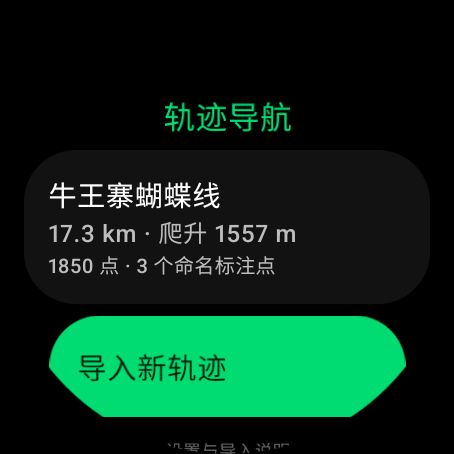
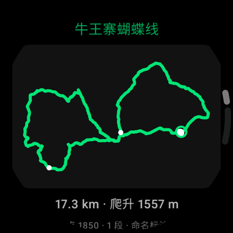
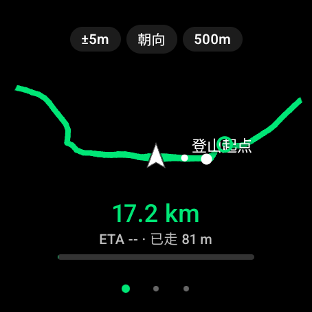
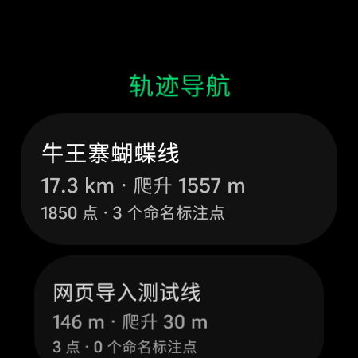

# 轨迹导航

Galaxy Watch4 Classic（Wear OS 3+）上的离线 GPX 轨迹导航应用。手表端单 APK，不依赖手机伴侣；导航期间不发起任何网络请求，网页导入只临时监听局域网。

<p align="center">
  
  
</p>
<p align="center">
  
  
</p>
<p align="center">
  
</p>

> 前四张为 Wear OS 4 模拟器（454×454，模拟 GPS）；最后一张为真机 SM-R8950（Galaxy Watch4 Classic 46mm，Android 16 / SDK 36）。真机导航与续航待实测。

## 功能

- **两步路 GPX 导入**：支持手机网页上传（手表生成二维码/地址）与 adb 推送；`<trk>` 多段、`<rte>` 回退、CDATA/emoji、只保留命名标注点、20 MB 上限、SHA-256 去重。
- **离线导航**：纯轨迹地图、朝向朝上/北向朝上、表圈缩放、全程概览、已走/未走分色。
- **偏航提醒**：阈值 30/50/100 m、持续判定、震动、回归点方位、回到轨迹自动解除；偏航和断点后可重新匹配真实轨迹位置。
- **标注点**：30 m 到达提醒；同名标注点独立计数；贴线倒退时提示“方向可能相反”。
- **状态可信度**：定位中断 10 秒后明确提示，过期缓存定位不用于开始或记录；罗盘不可用时显示“无罗盘”。
- **记录与导出**：自动记录实走 GPX；进程中断后残留记录在下次启动时自动恢复导出，半截轨迹点和空记录不会生成无效 GPX。
- **后台与续航**：前台服务 + OngoingActivity + 部分唤醒锁；亮屏 1 s、熄屏 5 s 采样；Ambient 简化界面。
- **设置**：偏航阈值、震动、默认朝向、导航常亮，全部持久化。
- **网络边界**：导航期间零网络；网页导入只在应用内临时监听局域网端口（随机 token、无外网请求），不集成统计、云同步或第三方地图。

## 快速开始

### 构建

需要 JDK 17 与 Android SDK（本项目在 `D:\Apps\androidsdk` 下验证）。

```bash
./gradlew testDebugUnitTest
./gradlew assembleRelease   # app/build/outputs/apk/release/app-release.apk
```

release 签名读取本地 `keystore.properties` 与 `keystore/`（已 gitignore）。这两个文件不随仓库分发；缺失时只能生成未签名 release 或使用 debug 包。

### 安装到手表

手表开启开发者选项与无线调试后：

```bash
adb pair <IP:配对端口> <配对码>
adb connect <IP:调试端口>
adb install -r app/build/outputs/apk/release/app-release.apk
```

手表端独立运行，无需手机 App。

### 导入路线

**方式一：手机网页上传（推荐）**

手表打开「轨迹导航」→「网页导入（手机上传）」，保持页面打开；手机与手表连同一个 Wi-Fi，扫码或输入表上地址，选择 `.gpx` 上传。上传成功后自动导入，回到路线库即可看到。

- 地址含一次性 token，离开网页导入页立即失效。
- 只接受 `.gpx`，单文件不超过 20 MB；明文 HTTP，仅建议在可信局域网使用。

**方式二：adb 推送**

```bash
tools\push-route.bat D:\path\route.gpx
```

然后手表「轨迹导航」→「从 import 目录导入（adb）」。也可手动推送：

```bash
adb push route.gpx /sdcard/Android/data/com.klkl.tracknav/files/import/
```

同内容文件只会导入一次；删除路线后可重新导入。

### 导出记录

```bash
tools\pull-records.bat
```

默认拉取到桌面 `tracknav-exports`。手表内导出目录：

```text
/sdcard/Android/data/com.klkl.tracknav/files/exports/
```

## 文档索引

- [AGENT.md](AGENT.md)：AI 代理工作约定——构建/模拟器/安全边界、提交后自动推送规则。
- **README.md**：本文件，功能、安装、导入/导出、验证状态与已知限制。
- [GLOSSARY.md](GLOSSARY.md)：轨迹、标注点、偏离、回归点、局域网上传页等领域术语。
- **ADR**：[0001 手表端单 APK/离线导航](docs/adr/0001-watch-only-offline-adb-import.md)、[0002 v1 无底图](docs/adr/0002-no-basemap-v1.md)、[0003 无 GMS 平台 GNSS](docs/adr/0003-gms-free-gnss-screen-off.md)、[0004 局域网上传页](docs/adr/0004-lan-web-upload.md)。
- [docs/screenshots](docs/screenshots/)：模拟器与真机截图。
- [逻辑与交互审查](docs/logic-interaction-review-2026-10-26.md)：26 项问题的修复状态与验证记录。

## 状态与限制

- 版本 `0.2.1`；54 个单元测试通过；Debug/Release 构建通过；已在 Wear OS 4 模拟器验证网页上传、Home 停服、回前台新 token、直线路线预览、导航、终点结束、后台记录与导出。
- 真机 **SM-R8950**（Galaxy Watch4 Classic 46mm，国行 `wiseulcn`，Android 16 / SDK 36，450×450，含 GMS）当前安装签名 v0.2.0；定位、通知、后台定位权限已授权，应用启动正常。
- 真机网页导入已用 PC 同热点验证：146 m 测试轨迹与 17.3 km「牛王寨蝴蝶线」均成功导入；离开上传页后服务停止。v0.2.1 的真机验收尚待进行。
- 待实测：1 km / 17 km 的 GPS 冷启动、罗盘/磁偏角、表圈、Ambient、前台通知与整段续航；手机浏览器上传路径待验。
- 网页导入需要手表连 Wi-Fi、页面保持打开；HTTP 无 TLS，地址 token 仅在离开页面前有效。
- 进程被杀后的“继续导航”尚未实现；已走轨迹会恢复导出。
- 自接近的回头弯路段存在 GPS 几何歧义，偏航判定需真机路线复验。
